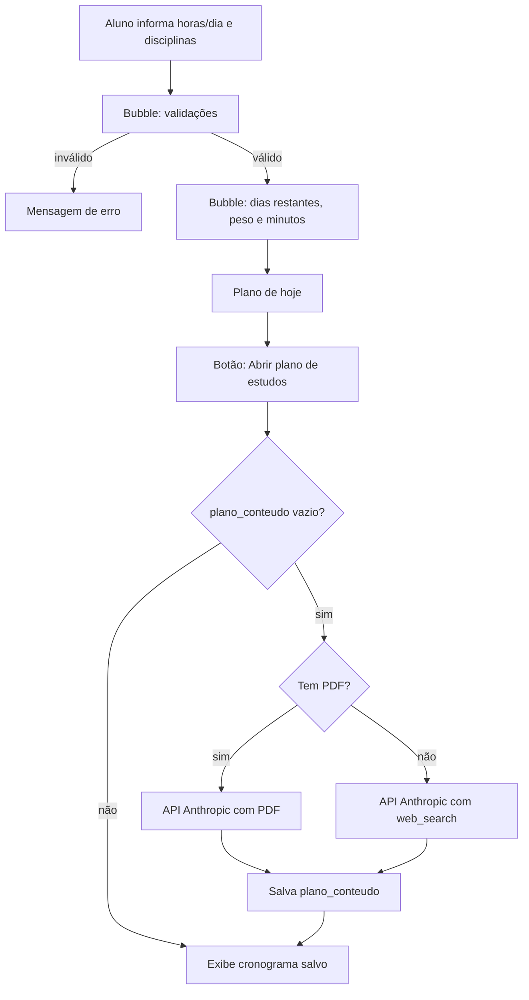

# Gerador de Plano de Estudo — Projeto Low-Code com Bubble

## Identificação

- **Plataforma:** Bubble (no-code/low-code)
- **Ferramentas de IA utilizadas:** Claude (planejamento e prompts), gerador de apps com IA do Bubble, API da Anthropic (geração do conteúdo do plano)
- **Link do app:**

---

## 1. Problema

Estudantes universitários com várias provas próximas não sabem dividir o tempo de estudo entre as disciplinas nem o que estudar em cada dia. Acabam estudando só a matéria preferida ou deixando tudo para a véspera.

O **Gerador de Plano de Estudo** calcula, a partir da data atual, quanto tempo dedicar a cada disciplina e monta um cronograma diário com o conteúdo a estudar até a data da prova.

---

## 2. Entrada

| Dado | Tipo | Obrigatório |
|---|---|:---:|
| Horas de estudo por dia | número decimal (0,5 a 12) | Sim |
| Nome da disciplina | texto | Sim |
| Data da prova | data futura | Sim |
| Dificuldade | 1 (fácil), 2 (média), 3 (difícil) | Sim |
| Horário de estudo | texto (ex.: 19:00) | Sim |
| Plano de ensino | arquivo PDF | Não |

---

## 3. Processamento

O sistema separa o que é **regra fixa** (calculada pelo Bubble) do que é **conteúdo** (gerado por IA).

### 3.1 Regras fixas (Bubble, sem IA)

1. `hoje` = data atual no momento do cálculo.
2. `dias_restantes` = data da prova − hoje.
3. Disciplinas com prova já realizada são ignoradas e listadas em "Provas realizadas".
4. `peso` = dificuldade; se `dias_restantes ≤ 3`, o peso é dobrado (urgência).
5. `minutos_hoje` = (peso ÷ soma dos pesos ativos) × horas por dia × 60.
6. Arredondamento para múltiplo de 5: `(valor ÷ 5):rounded to 0 × 5`.
7. Ordenação pela prova mais próxima.

### 3.2 Conteúdo (IA via API da Anthropic)

- Com PDF: a IA distribui os tópicos do plano de ensino pelos dias até a prova.
- Sem PDF: a IA pesquisa na web a ementa típica da disciplina e o app exibe o aviso de que o plano é uma sugestão.
- A resposta segue um formato fixo (`dd/mm | HH:MM-HH:MM | tópico | atividade`), que o Bubble transforma em tabela com `:split by`.

---

## 4. Saída

- **Página principal:** "Plano de hoje — [data]", com minutos por disciplina, dias restantes e selo **URGENTE**.
- **Página "plano":** cronograma dia a dia com horário, tópico e atividade, de amanhã até a véspera da prova, com a linha do dia atual destacada.

---

## 5. Arquitetura



### Estrutura de dados

| Data Type | Campo | Tipo |
|---|---|---|
| User | horas_por_dia | number |
| Disciplina | nome | text |
| Disciplina | data_prova | date |
| Disciplina | dificuldade | number |
| Disciplina | horario_estudo | text |
| Disciplina | plano_pdf | file |
| Disciplina | plano_conteudo | text |
| Disciplina | fonte | text ("PDF" ou "Sugestão IA") |
| Disciplina | dono | User |

Sem login, os dados ficam vinculados ao `Current User` anônimo do navegador. Uma *privacy rule* garante que cada usuário só veja as próprias disciplinas.

---

## 6. Prompts utilizados

O desenvolvimento foi incremental: cada versão do prompt foi criada a partir dos problemas encontrados na anterior. O gerador do Bubble limita o prompt a 2.500 caracteres.

### 6.1 Prompt inicial (gerador do Bubble)

```text
PAPEL: Desenvolvedor Bubble de apps simples e responsivos.

CONTEXTO: Universitários com várias provas próximas não sabem dividir o tempo de estudo entre as disciplinas.

PROBLEMA: Criar um "Gerador de Plano de Estudo" que calcule, a partir da data atual, quantos minutos estudar de cada disciplina HOJE. Recalcular ao abrir a página e ao clicar em "Gerar plano".

ENTRADA:
- Horas de estudo por dia (decimal).
- Disciplinas: nome, data da prova, dificuldade (1 fácil, 2 média, 3 difícil).

REGRAS:
1. Hoje = Current date/time.
2. dias_restantes = data da prova − hoje.
3. Prova já passada: ignorar no cálculo e listar em "Provas realizadas".
4. Peso = dificuldade; se dias_restantes ≤ 3, peso × 2.
5. Minutos = peso ÷ soma dos pesos ativos × horas/dia × 60, arredondado para múltiplo de 5.
6. Ordenar pela prova mais próxima.

SAÍDA: "Plano de hoje — [data]": nome, data da prova, dias restantes, minutos e selo "URGENTE" (≤ 3 dias). Total de minutos no final.

DADOS:
- Disciplina: nome, data_prova, dificuldade, dono (User).
- User: horas_por_dia.
- Sem login: vincular dados ao Current User e filtrar por ele. Privacy rule: só o dono vê.

INTERFACE: Página única em português: horas/dia, formulário de disciplina (dificuldade em dropdown), lista com editar/excluir (com confirmação), botão "Gerar plano", resultado e "Provas realizadas".

RESTRIÇÕES: Sem APIs, plugins pagos ou IA no cálculo. Máximo 8 disciplinas.

VALIDAÇÕES:
- Horas fora de 0,5 a 12: "Informe entre 0,5 e 12 horas por dia."
- Nome vazio: "Informe o nome da disciplina."
- Data hoje ou passada: "A data da prova deve ser futura."
- Sem dificuldade: "Escolha a dificuldade."
- Sem disciplinas ativas: "Adicione pelo menos uma disciplina."
- 9ª disciplina: "Limite de 8 disciplinas."

QUALIDADE: Workflows com nomes descritivos; validações via "Only when"; fórmula do peso em um único lugar.

TESTES:
1. 2h/dia; Cálculo (dif. 3, 10 dias), BD (dif. 2, 12 dias), Inglês (dif. 1, 15 dias) → 60, 40, 20 min.
2. Igual, Cálculo em 2 dias → 80 (URGENTE), 25, 15 min.
3. 1,5h/dia, uma disciplina → 90 min.
4. Horas = 0 → mensagem de erro, sem plano.
5. Data passada → erro, não adiciona.
6. Editar prova de 4 para 3 dias → vira URGENTE e ganha minutos.
7. Outro navegador → não vê as disciplinas do primeiro.
```

### 6.2 Refinamento: página "Plano de estudos" com conteúdo por IA

```text
CORREÇÕES E NOVA PÁGINA "PLANO DE ESTUDOS"

1. CORRIGIR MINUTOS: com uma única disciplina ativa, minutos = horas_por_dia × 60. Arredondar para múltiplo de 5 com (valor ÷ 5):rounded to 0 × 5. Exibir "X min hoje" no card do resultado. O peso deve ser dividido pela SOMA dos pesos ativos, não pela quantidade de disciplinas.

2. DADOS (em Disciplina):
- horario_estudo (text, ex.: "19:00"), obrigatório.
- plano_conteudo (text), plano_pdf (file), fonte (text).

3. CARD DO RESULTADO: botão "Abrir plano de estudos" que navega para a página "plano" enviando a Disciplina como data to send.

4. PÁGINA "plano" (type of content = Disciplina):
- Cabeçalho: nome, data da prova, dias restantes, minutos por dia, aviso de fonte.
- Ao carregar: se plano_conteudo estiver vazio, chamar a API da Anthropic (API Connector, chave Private) com nome, data de hoje, data da prova, minutos por dia, horario_estudo, dificuldade e URL do PDF (prefixar "https:"). Sem PDF, habilitar web_search. Salvar a resposta em plano_conteudo.
- Mostrar carregando durante a chamada.
- Tabela: Repeating Group de texts com fonte de dados plano_conteudo:split by (quebra de linha). Cada linha tem o formato "data | início-fim | tópico | atividade". Colunas: cada célula usa Current cell's text:split by (" | "):item #1, #2, #3 e #4.
- Destacar a linha da data de hoje.
- Botão "Regerar plano": limpa plano_conteudo e chama a API de novo.
- Botão "Voltar".

5. ERROS:
- Resposta "DISCIPLINA_NAO_RECONHECIDA": "Não reconheci a disciplina. Anexe o plano de ensino."
- Falha da API: "Não foi possível gerar o plano agora." com botão "Tentar novamente".

6. TESTES:
1. 2h/dia, uma disciplina → 120 min no card.
2. Prova em 56 dias → 56 linhas, uma por dia, a última de revisão.
3. horario_estudo 19:00 e 90 min → linhas com 19:00-20:30.
4. Com PDF → tópicos do PDF.
5. Sem PDF → aviso "Plano sugerido por IA".
6. Abrir de novo a página → não chama a API novamente.
```

### 6.3 Prompt de sistema da chamada à API (API Connector)

```text
Você é um planejador de estudos para estudantes universitários.

ENTRADA: disciplina, data de hoje, data da prova, minutos por dia (M),
horário de início (H), dificuldade (1 a 3) e, opcionalmente, o plano
de ensino em PDF.

TAREFA: criar um cronograma com UMA linha para CADA dia, de amanhã até
o dia anterior à prova.

REGRAS:
- Com PDF: use apenas os tópicos do plano de ensino, na ordem dele.
- Sem PDF: pesquise a ementa típica da disciplina em graduação.
- Cada sessão começa em H e dura exatamente M minutos.
- Distribua os tópicos proporcionalmente aos dias disponíveis.
- Os últimos 10% dos dias (mínimo 1) são revisão e exercícios.
- Dificuldade 3: mais exercícios; dificuldade 1: mais leitura.
- Não invente bibliografia, autores ou links.
- Se o nome não for uma disciplina acadêmica, responda apenas:
  DISCIPLINA_NAO_RECONHECIDA

FORMATO (obrigatório, texto puro, sem markdown, sem cabeçalho):
dd/mm | HH:MM-HH:MM | tópico | atividade
Uma linha por dia. Use " | " apenas como separador. Nenhum texto
antes ou depois das linhas.
```

Configuração: `max_tokens` de pelo menos 4000, para que cronogramas longos não sejam cortados.

---

## 7. Análise crítica

### 7.1 Decisões de projeto

| Decisão | Motivo |
|---|---|
| Cálculo de tempo por regra fixa, sem IA | Um LLM gera resultados diferentes a cada execução; regra fixa pode ser testada e defendida |
| IA apenas para o conteúdo | Distribuir tópicos de uma disciplina é tarefa de linguagem, adequada a um LLM |
| Formato de saída fixo da IA | Permite montar a tabela no Bubble e validar a resposta (horários, quantidade de linhas) |
| Cronograma gerado pela IA, não por workflows | Gerar um registro por dia exigiria workflows recursivos no Bubble |
| Dados vinculados ao `Current User` | Sem login, os dados de todos os visitantes ficariam visíveis entre si |
| Plano salvo em `plano_conteudo` | Evita chamar a API (e gastar) toda vez que a página abre |

### 7.2 Problemas encontrados durante o desenvolvimento

| # | Problema | Causa | Solução |
|---|---|---|---|
| 1 | Primeira versão mostrava só minutos por dia, não o que estudar | O escopo inicial não incluía conteúdo | Nova página "plano" com cronograma gerado por IA |
| 2 | Minutos exibidos incorretamente | | |
| 3 | O plano "X min/dia até a prova" ficava desatualizado | Os pesos mudam com a urgência e com provas já realizadas | Saída redefinida como "plano de hoje", recalculado a cada acesso |
| 4 | Risco de dados compartilhados entre visitantes | Ausência de login | Vínculo com `Current User` + privacy rule |

> Complete a linha 2 com a causa identificada no debugger do Bubble.

### 7.3 Riscos e limitações

- **Sem PDF, o plano é uma sugestão.** A IA não conhece o plano de ensino da instituição; a busca na web traz uma ementa típica. O app avisa isso ao usuário.
- **O cronograma usa os minutos do dia em que foi gerado.** Quando uma prova entra na janela de urgência, os minutos mudam, mas o cronograma salvo não. É preciso usar "Regerar plano".
- **Horários de disciplinas diferentes podem se sobrepor** se o aluno escolher o mesmo horário para todas.
- **Chave da API:** configurada como *Private* no API Connector, nunca exposta no front-end.
- **Custo:** cada geração consome créditos da API, especialmente com busca na web.
- **Arredondamento:** o total de minutos pode diferir em até 5 min do tempo disponível.

---

## 8. Casos de teste

Preencha a coluna "Obtido" ao executar cada teste.

### 8.1 Cálculo de tempo

| # | Tipo | Entrada | Esperado | Obtido | OK? |
|---|---|---|---|---|:---:|
| 1 | Normal | 2h/dia; Cálculo (dif. 3, 10 dias), BD (dif. 2, 12 dias), Inglês (dif. 1, 15 dias) | 60, 40, 20 min | | |
| 2 | Urgência | Mesmo cenário, Cálculo com prova em 2 dias | 80 (URGENTE), 25, 15 min | | |
| 3 | Limite | 1,5h/dia, uma disciplina | 90 min | | |
| 4 | Erro | Horas por dia = 0 | Mensagem de erro, sem plano | | |
| 5 | Erro | Data da prova no passado | Mensagem de erro, disciplina não adicionada | | |
| 6 | Recálculo | Editar prova de 4 para 3 dias | Vira URGENTE e ganha minutos | | |
| 7 | Isolamento | Abrir em outro navegador | Não vê as disciplinas do primeiro | | |

### 8.2 Plano de estudos (IA)

| # | Tipo | Entrada | Esperado | Obtido | OK? |
|---|---|---|---|---|:---:|
| 8 | Normal | Disciplina com PDF anexado | Tópicos do PDF distribuídos até a prova | | |
| 9 | Normal | "Estrutura de Dados" sem PDF | Plano com aviso "Plano sugerido por IA" | | |
| 10 | Limite | Prova em 56 dias | 56 linhas, a última de revisão | | |
| 11 | Limite | Prova amanhã | Uma linha de revisão | | |
| 12 | Formato | Horário 19:00 e 90 min | Linhas com 19:00-20:30 | | |
| 13 | Erro | Nome "asdfgh" | "Não reconheci a disciplina" | | |
| 14 | Erro | API indisponível | Erro amigável; minutos continuam aparecendo | | |
| 15 | Cache | Reabrir a página | Não chama a API novamente | | |

---

## 9. Comparação entre versões

Notas de 1 a 5.

| Critério | Versão inicial (só minutos) | Versão final (com cronograma) |
|---|---:|---:|
| Funcionamento correto | | |
| Atendimento ao problema | | |
| Clareza da interface | | |
| Organização dos workflows | | |
| Tratamento de erros | | |
| Facilidade de manutenção | | |

---

## 10. Reflexão

- **Onde a IA mais ajudou?**
- **Onde a IA errou ou gerou algo que precisei corrigir?**
- **Qual parte exigiu mais raciocínio humano?**
- **Consigo explicar cada workflow sem consultar a IA?**
- **Qual foi o principal risco identificado?**

---

## 11. Take Away

> Programar com IA não significa deixar a IA programar por mim. Significa...

### Cinco regras para usar IA de forma responsável

1.
2.
3.
4.
5.
